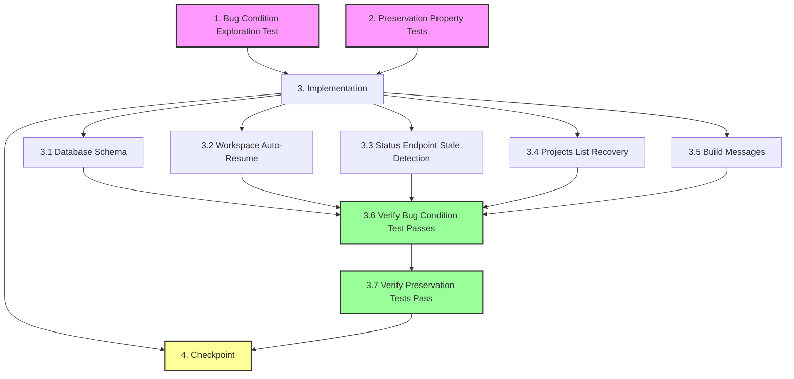

# Implementation Plan

## Overview

This task list implements the build session recovery bugfix using the bug condition methodology. The fix adds automatic recovery for orphaned builds (builds that continue in Totalum after user closes tab/refreshes/navigates away) by detecting them on workspace mount and projects list load, then resuming status polling to complete the build.

## Task Dependency Graph



```json
{
  "waves": [
    {
      "name": "Wave 1: Test Creation (BEFORE fix)",
      "tasks": ["1", "2"],
      "description": "Write exploration and preservation tests on UNFIXED code"
    },
    {
      "name": "Wave 2: Implementation",
      "tasks": ["3.1", "3.2", "3.3", "3.4", "3.5"],
      "description": "Implement recovery mechanisms in parallel"
    },
    {
      "name": "Wave 3: Verification",
      "tasks": ["3.6", "3.7"],
      "description": "Verify fix works and preserves existing behavior"
    },
    {
      "name": "Wave 4: Checkpoint",
      "tasks": ["4"],
      "description": "Final validation and manual testing"
    }
  ]
}
```

**Critical Path**: Tasks 1 and 2 (exploration and preservation tests) MUST be written and run on UNFIXED code BEFORE implementing the fix. Tasks 3.1-3.5 can be implemented in parallel. Tasks 3.6-3.7 verify the fix works and preserves existing behavior.

## Tasks

- [x] 1. Write bug condition exploration test
  - **Property 1: Bug Condition** - Orphaned Build Auto-Recovery on Return
  - **CRITICAL**: This test MUST FAIL on unfixed code - failure confirms the bug exists
  - **DO NOT attempt to fix the test or the code when it fails**
  - **NOTE**: This test encodes the expected behavior - it will validate the fix when it passes after implementation
  - **GOAL**: Surface counterexamples that demonstrate orphaned builds do not auto-recover
  - **Scoped PBT Approach**: Scope the property to concrete failing cases - projects with `totalumProjectId` and state "building" or "deploying" that are remounted after session interruption
  - Test implementation details from Bug Condition in design:
    - Generate test project: state = "building", totalumProjectId exists, simulating session interruption (no active polling)
    - Mount workspace component with the test project
    - Assert that status poll is triggered within 2 seconds of mount (from isBugCondition specification)
    - Mock Totalum to return "done" status
    - Assert project transitions to "ready" state with development URL set (from expectedBehavior specification)
  - Run test on UNFIXED code
  - **EXPECTED OUTCOME**: Test FAILS (workspace mounts but does not trigger immediate status poll, build remains in "building" state)
  - Document counterexamples found:
    - Tab close scenario: workspace mounts with orphaned build, shows "building" indefinitely
    - Page refresh scenario: workspace remounts but does not resume polling automatically
    - Navigation return scenario: projects list shows "building" with no recovery attempt
  - Mark task complete when test is written, run, and failure is documented
  - _Requirements: 2.1, 2.2, 2.3, 2.4, 2.5, 2.6, 2.7_

- [x] 2. Write preservation property tests (BEFORE implementing fix)
  - **Property 2: Preservation** - Active Build Behavior Unchanged
  - **IMPORTANT**: Follow observation-first methodology
  - Observe behavior on UNFIXED code for non-buggy inputs (active builds with no session interruption):
    - Start build, stay on workspace page (no tab close, refresh, or navigation)
    - Observe polling occurs every 10 seconds
    - Observe build completion triggers credit reconciliation, screenshot capture, GitHub push
    - Observe single-flight deduplication prevents duplicate completions
    - Observe orphaned builds with no totalumProjectId reset to "specification_ready"
  - Write property-based tests capturing observed behavior patterns from Preservation Requirements:
    - Test: Active builds poll every 10 seconds and complete normally (no interruption)
    - Test: Build failures transition to "build_failed" with error event
    - Test: Projects without totalumProjectId in "building" state reset to "specification_ready"
    - Test: Concurrent status polls use single-flight deduplication
    - Test: Deployment status polling operates independently from build status
    - Test: Non-active projects (state "ready", "plan_ready") return stored state without Totalum polling
  - Property-based testing generates many test cases for stronger guarantees
  - Run tests on UNFIXED code
  - **EXPECTED OUTCOME**: Tests PASS (confirms baseline behavior to preserve)
  - Mark task complete when tests are written, run, and passing on unfixed code
  - _Requirements: 3.1, 3.2, 3.3, 3.4, 3.5, 3.6, 3.7_

- [ ] 3. Implement build session recovery fix

  - [x] 3.1 Add database schema for lastPolledAt tracking
    - Add `lastPolledAt?: number` field to Project interface in `lib/store/types.ts`
    - Update project document schema to store last status poll timestamp
    - No migration needed - field is optional, will populate on next poll for active builds
    - _Bug_Condition: isBugCondition requires detecting "stale" builds (lastPolledAt > 5 minutes) vs active polling_
    - _Expected_Behavior: System SHALL track when builds were last polled to distinguish orphaned from active builds_
    - _Preservation: All existing project fields and schema behavior unchanged_
    - _Requirements: 2.1, 2.2, 2.3, 2.4, 2.5, 2.6, 2.7_

  - [x] 3.2 Implement workspace auto-resume on mount (operating-room.tsx)
    - Add useEffect hook in ProjectWorkspace component that fires once on mount
    - Condition: `project?.totalumProjectId && (state === "building" || state === "deploying")`
    - Action: Call `refreshStatus()` immediately to trigger first status poll
    - Add ref guard to fire only once per project (prevent duplicate triggers on re-renders)
    - Dependencies: `[project?.totalumProjectId, state, refreshStatus]`
    - Add user-facing toast: "Reconnecting to your build..." when auto-resume triggers
    - Only show toast for orphaned builds (detect by checking if statusData is null/undefined on mount)
    - Use user-facing language ("your project", "the builder"), never mention "Totalum"
    - _Bug_Condition: isBugCondition(input) where user returns to workspace with orphaned build (totalumProjectId exists, state "building"/"deploying", no active polling)_
    - _Expected_Behavior: expectedBehavior requires automatic status poll within 2 seconds of mount, resuming normal polling behavior_
    - _Preservation: Existing useProjectStatus hook behavior unchanged, still polls every 10 seconds after initial trigger_
    - _Requirements: 2.1, 2.2, 2.3, 2.4, 2.5_

  - [ ] 3.3 Implement stale build detection in status endpoint (status/route.ts)
    - Add lastPolledAt tracking: Update `lastPolledAt: Date.now()` on every status poll for projects in "building" or "deploying" state
    - Persist via `store.updateProject(id, { lastPolledAt: Date.now() })` before returning response
    - Add stale build detection before existing active polling logic (line ~119):
      - Condition: `active && project.lastPolledAt && (Date.now() - project.lastPolledAt > 5 * 60 * 1000)`
      - Log: `logger.info("api.projects.status", "stale build detected - resuming", { id, lastPolledAt, gapMs })`
      - Action: Continue to existing Totalum polling logic (no special handling needed)
    - Add recovery event when stale build completes:
      - When build transitions from "building" to "ready" on a stale poll
      - Append event: `event("build", "Build completed while you were away - welcome back!")`
      - Only fire once per recovery (check if lastPolledAt gap > 5 minutes)
    - _Bug_Condition: isBugCondition requires detecting when status poll gap > 5 minutes (session interruption occurred)_
    - _Expected_Behavior: expectedBehavior requires immediate status check on first poll after gap, completing build if Totalum reports "done"_
    - _Preservation: All existing completion logic (credit reconciliation, screenshot capture, GitHub push, runtime provisioning) runs identically_
    - _Requirements: 2.5, 2.6_

  - [ ] 3.4 Implement orphaned build recovery in projects list (projects/page.tsx)
    - Add useEffect that runs once on projects list page mount
    - Iterate through all projects in the list
    - Find orphaned builds: `state === "building" OR state === "deploying"` AND `totalumProjectId` exists
    - For each orphaned project, trigger background status check: `fetch(`/api/projects/${id}/status`)`
    - Use Set to track which projects have been checked (avoid duplicate fetches)
    - Trigger immediate status check (don't wait for interval)
    - Let existing SWR cache and UI refresh handle reactive updates
    - No user-facing toast needed (projects list updates silently in background)
    - _Bug_Condition: isBugCondition(input) where user views projects list with orphaned builds (totalumProjectId exists, state "building"/"deploying", viewed from projects list)_
    - _Expected_Behavior: expectedBehavior requires automatic background status check on projects list mount, completing builds if Totalum reports "done"_
    - _Preservation: Projects list rendering and SWR caching behavior unchanged, only adds background recovery trigger_
    - _Requirements: 2.7_

  - [ ] 3.5 Update user-facing build messages (lib/build-messages.ts)
    - Review existing build-related messages in build-messages.ts
    - Ensure no messages mention "Totalum" (use "the builder" or "your build" instead)
    - Add message for build recovery scenario: "Reconnecting to your build..."
    - Add message for completed-while-away scenario: "Build completed while you were away - welcome back!"
    - Verify all messages use encouraging, non-technical language consistent with Atai brand
    - _Bug_Condition: User returns to orphaned build and needs feedback about recovery_
    - _Expected_Behavior: Clear, encouraging messages inform user that system is reconnecting automatically_
    - _Preservation: All existing build messages unchanged, only adds recovery-specific messages_
    - _Requirements: 2.1, 2.2, 2.6_

  - [ ] 3.6 Verify bug condition exploration test now passes
    - **Property 1: Expected Behavior** - Orphaned Build Auto-Recovery on Return
    - **IMPORTANT**: Re-run the SAME test from task 1 - do NOT write a new test
    - The test from task 1 encodes the expected behavior
    - When this test passes, it confirms the expected behavior is satisfied
    - Run bug condition exploration test from step 1:
      - Generate test project: state = "building", totalumProjectId exists
      - Mount workspace component with the test project
      - Assert that status poll is triggered within 2 seconds of mount
      - Mock Totalum to return "done" status
      - Assert project transitions to "ready" state with development URL set
    - **EXPECTED OUTCOME**: Test PASSES (workspace detects orphaned build, triggers immediate status poll, completes build)
    - Verify auto-resume triggers on workspace mount
    - Verify stale build detection logs reconnection
    - Verify build completes with all expected side effects (credits, screenshot, GitHub, runtime)
    - _Requirements: Expected Behavior Properties from design (2.1, 2.2, 2.3, 2.4, 2.5, 2.6, 2.7)_

  - [ ] 3.7 Verify preservation tests still pass
    - **Property 2: Preservation** - Active Build Behavior Unchanged
    - **IMPORTANT**: Re-run the SAME tests from task 2 - do NOT write new tests
    - Run preservation property tests from step 2:
      - Active builds poll every 10 seconds and complete normally
      - Build failures transition to "build_failed" with error event
      - Projects without totalumProjectId in "building" state reset to "specification_ready"
      - Concurrent status polls use single-flight deduplication
      - Deployment status polling operates independently
      - Non-active projects return stored state without Totalum polling
    - **EXPECTED OUTCOME**: Tests PASS (confirms no regressions in active build behavior)
    - Verify polling interval remains 10 seconds for active builds
    - Verify completion logic (credit reconciliation, screenshot, GitHub push) unchanged
    - Verify single-flight deduplication still prevents duplicate completions
    - Verify orphaned builds with no totalumProjectId still reset to "specification_ready"
    - _Requirements: Preservation Requirements from design (3.1, 3.2, 3.3, 3.4, 3.5, 3.6, 3.7)_

- [ ] 4. Checkpoint - Ensure all tests pass
  - Run full test suite (unit + integration + property-based tests)
  - Verify bug condition exploration test passes (orphaned builds auto-recover)
  - Verify preservation tests pass (active builds unchanged)
  - Test manually with real build scenarios:
    - Start build, close tab after 30s, reopen workspace → verify auto-resume and completion
    - Start build, refresh page at 50% → verify polling resumes immediately
    - Start build, navigate to projects list → verify background recovery
    - Start deployment, close tab, return later → verify deployment completes with production URL
  - Review logs for proper stale build detection and recovery events
  - Ensure all user-facing messages are encouraging and never mention "Totalum"
  - Ask user if questions arise or if further testing scenarios are needed
  - _Requirements: All (2.1-2.7, 3.1-3.7)_

## Future Enhancement (Not in Current Scope)

- [ ] 5. Optional: Implement background recovery job (cron/build-recovery.ts)
  - This is a FUTURE ENHANCEMENT, not required for the current bugfix
  - Query stale builds: `state IN ["building", "deploying"]` AND `totalumProjectId` exists AND `lastPolledAt < NOW() - 5 minutes`
  - For each stale build, call status endpoint or directly call `getAgentStatus`
  - Complete builds if Totalum reports "done"
  - Rate limit: process up to 10 stale builds per run
  - Add comprehensive logging for observability
  - Schedule to run every 5 minutes via cron or serverless function
  - _Note: This adds redundancy but is not critical for user-initiated recovery_
  - _Requirements: 2.6, 2.7 (additional recovery path)_


## Notes

### Implementation Order

1. **Test First**: Write bug condition exploration test (task 1) and preservation tests (task 2) on UNFIXED code BEFORE implementing any fixes. The exploration test MUST fail (proving bug exists), and preservation tests MUST pass (establishing baseline).

2. **Parallel Implementation**: Tasks 3.1-3.5 can be implemented in any order or in parallel as they modify different files:
   - 3.1: Database schema (lib/store/types.ts)
   - 3.2: Workspace component (components/workspace/operating-room.tsx)
   - 3.3: Status endpoint (app/api/projects/[id]/status/route.ts)
   - 3.4: Projects list (app/projects/page.tsx)
   - 3.5: Build messages (lib/build-messages.ts)

3. **Verification**: After all implementation tasks complete, re-run the SAME tests from tasks 1 and 2:
   - Task 3.6: Bug condition test should now PASS (proving fix works)
   - Task 3.7: Preservation tests should still PASS (proving no regressions)

### Key Constraints

- **Never mention "Totalum"**: All user-facing messages must use "the builder", "your build", or "your project"
- **Use Property N format**: Exploration and preservation tests MUST use `**Property N: Type** - [Title]` format for hover status to work
- **Standalone tests**: Exploration (task 1) and preservation (task 2) tests are standalone tasks, NOT sub-tasks
- **Observation-first**: Preservation tests must observe UNFIXED code behavior first, then codify that behavior

### Testing Approach

- **Bug Condition (Property 1)**: Property-based test scoped to concrete failing cases (projects with totalumProjectId, state "building"/"deploying", session interrupted)
- **Preservation (Property 2)**: Property-based tests across the input domain (active builds with no interruption, various completion scenarios)

### Manual Testing Scenarios

After automated tests pass, manually verify:
1. Tab close → reopen workspace → auto-resume and completion
2. Page refresh at 50% → polling resumes immediately
3. Navigate away → return to projects list → background recovery
4. Browser crash simulation → return later → orphaned build completes

### Future Enhancement

Task 5 (background recovery job) is optional and out of scope for this bugfix. It provides redundancy but is not critical since user-initiated recovery (workspace mount, projects list load) handles the primary use cases.
